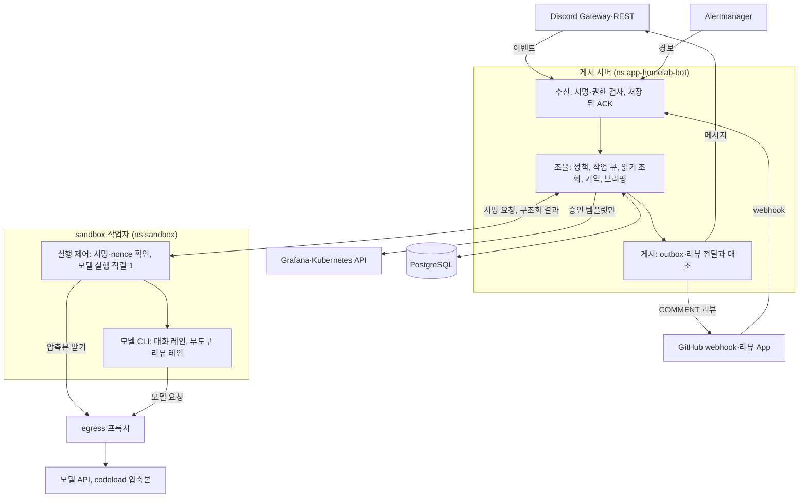

# homelab-bot

홈랩 운영을 돕는 Discord 봇이다. 허용한 채널에서 대화·읽기 조회·기억·브리핑을 제공하고, GitHub PR에는 `COMMENT` 리뷰를 남긴다.
모델 호출은 격리된 sandbox 작업자에서만 하고, 수신·권한·저장·게시는 게시 서버가 맡는다.

## 사용 기술

버전은 여기에 적지 않는다. 원본은 `.node-version`(Node), `package.json`·`package-lock.json`(의존성), `Dockerfile`(기반 이미지·CLI 확인)이다.

- **언어·런타임:** TypeScript, Node.js
- **데이터:** PostgreSQL(CNPG), `pg`. inbox·작업 큐·outbox를 DB에 둔다
- **Discord:** Gateway(Node 내장 WebSocket)·REST 직접 구현. SDK 없음
- **GitHub:** GitHub App(PR 리뷰), webhook, codeload 압축본
- **모델 실행기:** Claude Code CLI(구독 토큰), Codex CLI. 작업자 env의 프로필로 고른다
- **격리:** sandbox 작업자, egress 프록시, Ed25519 서명 capability
- **읽기 조회:** Grafana(VictoriaMetrics·VictoriaLogs), Kubernetes API(Argo CD Application CR 포함)
- **운영:** Infisical 비밀값, Alertmanager 경보 수신, `/metrics` 지표, healthchecks.io 하트비트
- **라이브러리·시험:** zod, undici, `node:test`, PGlite
- **빌드·배포:** Docker 다단계 이미지, GitHub Actions(homelab `app-build`)

## 아키텍처



게시 서버는 Discord Gateway와 GitHub webhook을 받아 권한을 검사하고, DB에 저장한 뒤 outbox로 게시한다.
sandbox 작업자는 모델만 실행한다. 대화와 리뷰는 실행 자리 하나를 함께 써서 한 번에 하나만 돈다.

**레인**

- **대화:** 멘션, `/chat`, `/urgent`, 활성 스레드의 후속 메시지. 작업자의 모델을 부른다.
- **읽기 조회:** `/read`. 승인 템플릿만 실행한다. 모델을 부르지 않고 모델 슬롯에 막히지 않는다.
- **기억:** `memory-*` 명령. 게시 서버가 모델 없이 처리한다. 삭제 원장을 설정했을 때만 열린다.
- **브리핑:** 설정한 시각에 게시 서버가 모델 없이 만들어 보낸다. 삭제 원장을 설정해야 켤 수 있다.
- **PR 리뷰:** webhook으로 시작한다. 작업자는 고정 SHA의 codeload 압축본만 받고 도구 없이 모델을 돌린다. 스위치와 정책·작업자 조건이 맞을 때만 열린다.
- **작업:** 코드 경로만 있다. `/task`를 등록하지 않고 어떤 실행기에도 연결하지 않는다.

**신뢰 경계**

- **자격:** 모델 자격은 작업자에만, Discord 토큰과 GitHub App 키는 게시 서버에만 둔다.
- **제어:** 작업자는 게시 서버의 Ed25519 서명 capability가 있는 요청만 실행한다. 작업자에는 공개 키만 둔다.
- **네트워크:** 공개 수신 경로는 GitHub webhook 하나다. Discord는 Gateway로 받고, 작업자의 외부 통신은 egress 프록시로 나간다.
- **입력:** PR·댓글·로그는 비신뢰 자료로 넘긴다. 모델 출력은 게시 서버가 검증한 뒤에만 게시한다.
- **조회:** 읽기 계정과 승인 템플릿만 쓴다. 로그 원문은 공개 스레드에 올리지 않는다.

## 문서

- [ARCHITECTURE](docs/ai-bot/ARCHITECTURE.md): 구조와 계약. 실행 방법·환경 변수·버전 고정은 §14
- [DECISIONS](docs/ai-bot/DECISIONS.md): 결정과 근거
- [VERIFICATION](docs/ai-bot/VERIFICATION.md): 시험·실연동 결과
- [PROJECT_STATUS](docs/ai-bot/PROJECT_STATUS.md): 진행 상황
- [V1_PLAN](docs/ai-bot/V1_PLAN.md): V1 범위와 시험 계획

## 로컬 명령

```sh
npm ci
npm run check
npm test
```
